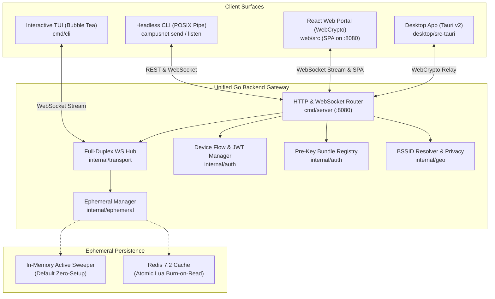

# CampusNet: High-Security Ephemeral Communications Network

[](https://golang.org)
[](https://reactjs.org/)
[](https://vitejs.dev/)
[](https://tauri.app/)
[](LICENSE)
[]()

CampusNet is a high-security, campus-focused ephemeral communications network engineered with zero-knowledge end-to-end encryption (E2EE), client-side Double Ratchet and Extended Triple Diffie-Hellman (X3DH) key agreement, forward secrecy, sub-second burn-on-read ephemerality, and privacy-preserving campus access point (BSSID) location zones.

The architecture decouples client surfaces (Interactive Bubble Tea Terminal TUI, Headless POSIX CLI pipe, WebCrypto React SPA, and Tauri Desktop wrapper) from a unified Go gateway backend. Plaintext message bodies and private cryptographic keys never touch the server or unencrypted disk. The server acts purely as a public-key bundle registry, blind envelope router, and ephemeral Redis-backed message cache.

---

## Architecture & System Topology



---

## Key Security & Architectural Invariants

1. **Zero-Knowledge Blind Relay**: Plaintext message bodies and private cryptographic keys **never** touch the server or unencrypted storage. The server operates strictly as a blind relay and public-key bundle registry.
2. **Sub-Second Burn-on-Read**: When an encrypted envelope is delivered and acknowledged (`ACK_READ`), an atomic Redis Lua script unlinks and cryptographically zeroes the message buffer in memory.
3. **Double Ratchet with Forward Secrecy**: Every conversation utilizes symmetric KDF chain ratchets and Diffie-Hellman ratchets. Out-of-order messages are handled through a bounded skipped-key cache with memory zeroization.
4. **BSSID Privacy Zero-Bypass**: Campus Wi-Fi AP BSSIDs are hashed using HMAC-SHA256 with campus salt. When the privacy toggle is disabled (`location_enabled == false`), telemetry is completely scrubbed and null vectors are dispatched to peers.
5. **Universal Cross-Surface Compatibility**: Seamless symmetric E2EE encryption allows the Terminal TUI, Headless CLI, Web Browser, and Desktop App to exchange encrypted messages interchangeably.
6. **Offline Delivery Queue**: Messages sent to offline peers remain securely cached in the ephemeral store and are immediately delivered upon reconnecting, provided their millisecond TTL has not expired.

---

## Directory Structure

```
hit-chat/
├── memory-roadmap.md                 # Context ledger & operational roadmap
├── launch-all.bat                    # 1-Click All-in-One Launcher (Server + Web + CLI)
├── run-server.bat                    # Standalone Gateway Server Runner
├── run-cli.bat                       # Standalone Terminal TUI Runner
├── run-web.bat                       # Standalone Web Dev Server Runner
├── Makefile                          # Unified build & test automation
├── Dockerfile                        # Multi-stage production container build
├── docker-compose.yml                # Redis 7.2 + PostGIS 16 + Gateway
├── go.mod & go.sum                   # Go backend module dependencies
├── bin/                              # Pre-compiled standalone binaries
│   ├── campusnet-server.exe          # Unified backend gateway & web server (11.6 MB)
│   └── campusnet-cli.exe             # Interactive TUI & headless client (12.4 MB)
├── api/
│   ├── proto/v1/                     # envelope.proto, auth.proto, geo.proto
│   └── openapi/openapi.yaml          # OpenAPI 3.0 REST specification
├── pkg/protocol/
│   ├── envelope.go                   # Cryptographic envelope schemas & TTL validation
│   ├── messages.go                   # StreamFrame opcodes & presence structures
│   └── errors.go                     # Standard protocol error definitions
├── internal/
│   ├── auth/                         # Device flow (RFC 8628), JWT claims, bundle registry
│   ├── crypto/                       # Curve25519 ECDH, AES-256-GCM, HKDF, DPAPI keyring
│   ├── ephemeral/                    # Millisecond TTL manager, atomic Lua burn script, memory store
│   ├── geo/                          # BSSID HMAC hashing, zero-bypass privacy, Wi-Fi sniffers
│   └── transport/                    # Full-duplex WebSocket hub, REST routing, SPA static hosting
├── cmd/
│   ├── server/main.go                # Gateway entrypoint with graceful shutdown & flags
│   └── cli/                          # CLI router, Bubble Tea TUI, headless pipelines
├── web/                              # React + Vite + Tailwind CSS Web Portal
│   ├── dist/                         # Compiled production SPA assets
│   └── src/                          # WebCrypto keys, browser ratchet, countdown timers
└── desktop/                          # Tauri v2 native desktop wrapper
    └── src-tauri/                    # Rust backend configuration & application shell
```

---

## Quickstart & Launching

### Option A: 1-Click All-in-One Launcher (Windows)
Double-click `launch-all.bat` in the project root:
- Starts `campusnet-server.exe` on port `8080` (hosting both REST/WebSocket API and React Web Client).
- Opens the Web Portal automatically in your default browser at `http://localhost:8080`.
- Launches the interactive Bubble Tea Terminal client in a dedicated console.

### Option B: Standalone Pre-Compiled Binaries
```bash
# 1. Start the Gateway Server (runs zero-setup in-memory, or with --redis)
./bin/campusnet-server.exe -port 8080

# 2. In another terminal, launch the Interactive Terminal TUI
./bin/campusnet-cli.exe

# 3. Open Web Client in any browser
http://localhost:8080
```

### Option C: Docker Compose (Full Stack)
```bash
# Launch Gateway + Redis 7.2 + PostgreSQL 16 PostGIS
docker compose up -d

# Verify health
curl http://localhost:8080/api/v1/health
```

---

## Terminal CLI Reference (`campusnet-cli.exe`)

```
CampusNet CLI - High-Security Ephemeral Communications

USAGE:
  campusnet [command] [flags]

COMMANDS:
  tui                  Launch interactive split-screen Terminal UI (default, auto-connects)
  connect              Auto-authorize and establish live connection to gateway
  pair                 Initiate RFC 8628 terminal device authorization (--auto for instant)
  send --to @user      Send encrypted ephemeral message with burn timer (--user/--from)
  listen               Stream incoming decrypted messages from gateway (--user)
  version              Display client engine version information
  help                 Display help options
```

### Examples
```bash
# Launch interactive TUI client (auto-connects out-of-the-box)
campusnet

# Auto-connect and verify authenticated WebSocket stream as @student_guest
campusnet connect --user @student_guest

# Instant terminal pairing without browser code entry
campusnet pair --auto --user @campus_dev

# Send an encrypted ephemeral message from @bob to @alice with 5-second burn timer
campusnet send --from @bob --to @alice --ttl 5000 "Robotics Lab code: 8841"

# Pipe message payload via standard POSIX stdin stream
echo "Encrypted coordinate payload" | campusnet send --from @bob --to @alice

# Stream decrypted incoming messages in real-time JSON format
campusnet listen --user @alice --format json
```

---

## Interactive TUI Hotkeys

| Hotkey | Function |
|:---:|---|
| `Tab` / `Down` | Switch active conversation peer |
| `Enter` | Dispatch E2EE encrypted ephemeral message with 15s burn timer |
| `Ctrl + A` | Instant Auto-Connect and session token authorization |
| `Ctrl + P` | Toggle Campus Location Broadcasting / Zero-Bypass Privacy switch |
| `Ctrl + L` | **Emergency Screen & RAM Shred** (Purges in-memory buffers immediately) |
| `Esc` / `Ctrl + C` | Graceful exit with terminal alternate screen restoration |

---

## REST & WebSocket API Specification

| Method | Endpoint | Description |
|:---:|---|---|
| `GET` | `/api/v1/health` | Gateway health check and service telemetry |
| `POST` | `/api/v1/auth/session` | Mint immediate authenticated session token |
| `POST` | `/api/v1/auth/device/code` | Request RFC 8628 device verification code |
| `POST` | `/api/v1/auth/device/token` | Poll for terminal device authorization |
| `POST` | `/api/v1/auth/device/verify` | Approve device login via user code |
| `GET` | `/api/v1/auth/device/pending` | List pending terminal authorization requests |
| `POST` | `/api/v1/auth/device/auto` | Instant 1-click terminal auto-authorization |
| `POST` | `/api/v1/crypto/bundle` | Upload client public pre-key bundle (X3DH) |
| `GET` | `/api/v1/crypto/bundle/{target}` | Fetch peer pre-key bundle for handshake |
| `POST` | `/api/v1/geo/resolve` | Resolve Wi-Fi AP BSSID hash to campus zone |
| `WS` | `/ws/v1/stream?token={jwt}` | Authenticated full-duplex E2EE stream |
| `GET` | `/*` | Embedded React SPA static hosting & client-side routing |

---

## Verification & Test Suite

All unit tests, integration suites, and cross-surface interop checks are verified passing:

```bash
# Run all Go subsystem unit tests
go test ./...

# Build production Web client assets
npm --prefix web run build

# Run automated end-to-end auto-connect & messaging test suite
python scratch/test_auto_connect.py
python scratch/verify_improvements.py
```

---

## License

MIT License. Designed and engineered for high-security campus ephemeral communications.
